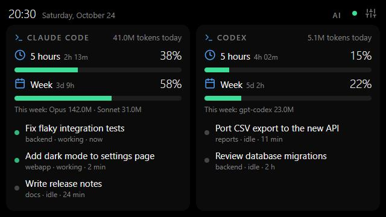
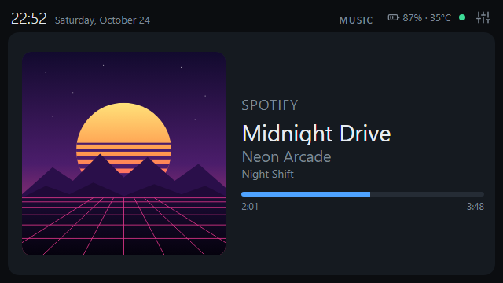
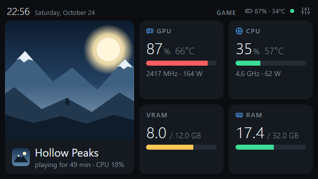

<p align="center">
  
</p>

<h1 align="center">SpareScreen</h1>

<p align="center">Turn an old phone (or any device with a browser) into a live dashboard for your PC.</p>

<p align="center">
  <a href="https://github.com/gustacassel/SpareScreen/actions/workflows/ci.yml"></a>
  <a href="LICENSE"></a>
</p>

<p align="center">
  
</p>

<p align="center">
  
  
  
</p>
<p align="center">
  
  
</p>

Turn that old phone in your drawer into a live dashboard for your computer.
Your PC runs a small Python agent that collects the data and serves a web page;
the phone (or any device with a browser) just opens that page.

The page has screens that rotate on their own (or with a tap):

- **Hardware:** CPU and GPU usage, temperature, power and clock, per-core load,
  VRAM, RAM and swap.
- **AI:** for each AI coding tool installed on the PC (Claude Code and Codex for now):
  usage limits (5-hour and weekly windows), tokens used today and this week per model,
  and your sessions (and which ones are working).
- **PC:** the app in focus, the heaviest apps, fans, network, free disk space and drive
  temperatures. The running game and what's playing also show here when game mode or the
  Music screen is turned off.
- **Music:** while something plays, the album cover, title, artist, album, the player
  (with its icon) and the progress.
- **Game:** while a game runs, game mode shows only this screen: the game's art and icon,
  how long you've been playing, and GPU/CPU usage, temperature, clock and power, VRAM and
  RAM. When the game closes, the normal screens come back.

When a Claude Code or Codex session finishes, the page jumps to the AI screen, shows
the session name and plays a short chime (sound only works after the first tap on the
screen, a browser rule).

Runs on Windows, Linux and macOS, with any device that has a browser.
Free and open source (MIT license). Ideas and next steps in [ROADMAP.md](ROADMAP.md).

## Getting started

### Download (easiest)

Grab the file for your system from the [latest release](https://github.com/gustacassel/SpareScreen/releases/latest)
and run it. No Python needed.

| System | File | How to run |
|---|---|---|
| Windows | `sparescreen-windows-x64.exe` | Double-click it. Windows SmartScreen may warn about an unknown app: *More info > Run anyway*. |
| Linux | `sparescreen-linux-x64` | `chmod +x sparescreen-linux-x64` once, then `./sparescreen-linux-x64` |
| macOS (Apple Silicon) | `sparescreen-macos-arm64` | `chmod +x sparescreen-macos-arm64`, then run it from Terminal. The first time macOS blocks it: *System Settings > Privacy & Security > Open Anyway*. |

When you start it by hand it opens the **SpareScreen window** on the PC (see below).
The files aren't code-signed yet, which is why the systems warn the first time.

On Windows, double-clicking it runs SpareScreen in the background with an icon in the
tray (next to the clock): closing the window doesn't stop it. Click the icon to open the
window again; right-click it for the dashboard, the phone address and pairing code,
**Start with Windows** and Quit. Windows 11 puts new icons behind the **^** arrow; drag it
onto the taskbar to keep it in sight. Typed in a terminal, it runs right there, as before.

### The SpareScreen window (on the PC)

A small window (an Edge or Chrome app window; a browser tab where neither is installed)
with three tabs, kept live. A dot on a tab means something there needs you:

- **Phone:** the Wi-Fi address and the pairing code; when a new device asks to pair, the
  window jumps here and shows the code in big digits. Below, the devices: phones on USB
  (with battery level and temperature), the paired Wi-Fi device (with a Remove button) and
  every screen that has the dashboard open right now.
- **Games:** the game now (and how it was recognized), your games, the programs running
  now to mark as games, and the ones marked "not a game" (see *Games and apps*).
- **Status:** what works and what's missing, with a button to fix it where possible:
  install or open LibreHardwareMonitor (CPU sensors on Windows), turn on FPS in games,
  install adb (USB cable), plus GPU, Wi-Fi, AI tools and now playing.

At the bottom, **Start with Windows** (or "Start when I log in" elsewhere); at the top,
**Open dashboard**.

It answers only to this PC (`http://localhost:8765/panel.html`); other devices and other
websites can't read it or press its buttons.

### From source

You need [Git](https://git-scm.com/) and [Python](https://www.python.org/) 3.9 or newer.
Download the project and enter the folder:

```bash
git clone https://github.com/gustacassel/SpareScreen.git
```

```bash
cd SpareScreen
```

Create a Python environment just for it:

```bash
python -m venv .venv
```

Activate it (Windows: `.venv\Scripts\activate`; Linux/macOS: `source .venv/bin/activate`) and install:

```bash
pip install -e .
```

```bash
sparescreen
```

You can connect the phone in two ways: over Wi-Fi or with a USB cable.

### Over Wi-Fi

The agent prints the address to open on the phone, something like `http://192.168.0.10:8765`,
and a 6-digit **pairing code**. The phone must be on the same Wi-Fi network as the PC.
Any device with a browser works: Android, iPhone, iPad, a tablet, another computer.

The first time, the page asks for the pairing code: type it once and that device is
remembered (even after the agent restarts). Devices that haven't paired can't see any
data or change settings. The PC itself and phones on USB don't need the code.

One Wi-Fi device is paired at a time: pairing a new one disconnects the previous one
(it asks for the code again). The SpareScreen window shows who is asking to pair and
lets you remove the paired device.

**The PC's name instead of its IP.** The router can give the PC a new IP, and then the
phone loses the page. So, once connected by IP, the page tries the PC's names from the
phone (`yourpc.local`, which the PC answers itself over mDNS, and `yourpc`, which many
routers know) and moves to the first one that works, keeping the pairing. iPhones
resolve `.local`; Android does from version 12. The SpareScreen window shows which
address worked. If none does, the page stays on the IP and tries again a day later.

### With a USB cable (Android)

Works without Wi-Fi and keeps the phone charging. It uses `adb reverse`, so the
phone reaches the agent at `http://localhost:8765` through the cable.

1. Install `adb` (Android Platform Tools) on the PC:
   - Windows: `winget install Google.PlatformTools`
   - macOS: `brew install --cask android-platform-tools`
   - Linux (Debian/Ubuntu): `sudo apt install adb`
2. On the phone, enable USB debugging: open *Settings > About phone*, tap
   *Build number* 7 times, then turn on *Developer options > USB debugging*
   (menu names vary a little between brands).
3. Run `sparescreen` and plug in the cable. The first time, accept the
   "Allow USB debugging?" prompt on the phone (check "Always allow").
4. The page opens by itself in the phone's browser. Unplug and plug it back in and it
   comes back by itself.

The cable must carry data (some cheap cables only charge). If the agent can't find
`adb`, use `--adb PATH`. On Windows, some phones need the manufacturer's USB driver.

### Start with your PC

On Windows the easiest way is the tray icon's **Start with Windows**. Or, on any system,
to have SpareScreen start by itself when you log in, in the background with no window:

```bash
sparescreen --autostart on
```

Any other options you pass are kept (e.g. `sparescreen --stay-awake --autostart on`).
`--autostart off` undoes it and `--autostart status` shows what is registered. It works
per user, without admin rights: a *Run* entry on Windows, `~/.config/autostart` on Linux
and a LaunchAgent on macOS (from the next login). In the background the output goes to
`~/.sparescreen/sparescreen.log`. With the downloaded executable it's the same:
`sparescreen-windows-x64.exe --autostart on`.

In the background SpareScreen shows a tray icon (quit from its menu). It's built in on
Windows; on Linux and macOS it shows up if `pystray` and `pillow` are installed
(`pip install pystray pillow`) and the desktop supports tray icons. `--no-tray` turns it off.

### Options

| Option | Default | What it does |
|---|---|---|
| `--port` | `8765` | HTTP port |
| `--host` | `0.0.0.0` | Address to listen on. USB only: use `127.0.0.1` so nothing is exposed on the network |
| `--interval` | `1` | Seconds between readings |
| `--no-usb` | | Don't look for phones on USB |
| `--adb` | auto | Path to `adb` |
| `--no-open` | | Don't open the page on the phone when it connects |
| `--stay-awake` | | Turns on the phone's "stay awake while plugged in" setting (saved on the phone) |
| `--no-pairing` | | Let any device on the network see the data without a code (trusted networks only) |
| `--reset-pairing` | | Forget every paired device before starting |
| `--background` | | Run without a window (tray icon where possible), output to `~/.sparescreen/sparescreen.log` |
| `--no-tray` | | No tray icon in the background |
| `--dev` | | Development mode (see below) |
| `--demo` | | Show made-up data instead of this PC's (for screenshots, demos or trying it out) |
| `--autostart` | | `on`, `off` or `status`: start SpareScreen when you log in (see above) |
| `--version` | | Print the version |

## On the phone

1. Open the address in the browser (automatic over USB).
2. Tap the screen to go full screen. Each tap goes to the next screen
   (or closes an open notification).
3. Long press (hold ~1 second) switches the theme.
4. The gear icon in the top corner opens **settings**: theme, which screens rotate,
   how often to switch, Claude alerts, sound, fan names, which fan shows on the CPU card,
   game mode, burn-in protection and night mode. Everything is saved on the PC
   (`~/.sparescreen/config.json`), so it survives reloading the page. Opened on the PC
   itself, the settings also show the phone address and the pairing code.
5. To keep the screen on: use `--stay-awake` over USB, or keep the phone charging and
   turn on *Developer options > Stay awake*.

Themes: Graphite, OLED, Terracotta, Neon, Terminal and Light.

<p align="center">
  
  
  
</p>

For testing you can force things in the address: `…:8765/?screen=pc` pins one screen
(`hardware`, `ai`, `pc`, `music` or `game`) and `…:8765/?theme=neon` forces a theme.

## Burn-in protection and night mode

A dashboard shows the same things in the same place for hours, which can burn into
OLED/AMOLED screens (many older phones have one).

- **Burn-in protection** (on by default): every minute the whole page moves a few pixels,
  too little to notice.
- **Night mode** (off by default): during the night hours you pick (22–7, 23–7 or 0–8),
  the screen either dims or shows only a dim clock that moves around every minute.
  Tap it to see the dashboard for a minute. Alerts (session finished, battery hot) still
  show up on top.

## Phone battery

Leaving an old phone plugged in all day (and maybe inside a warm PC case) is hard on its
battery: heat and age are what make lithium batteries swell. So the top bar shows the
phone's own battery:

- **Over USB:** level and temperature, read with `adb` every 30 seconds. It turns yellow
  from 38 °C, and from 42 °C (or when Android itself reports "overheat") it turns red and
  shows an alert with a chime, so you can unplug the phone or give it more air.
- **Over Wi-Fi:** only the level, and only where the browser reports it; browsers don't
  expose the temperature.

If the back of the phone ever starts to bulge, unplug it and stop using it.

## Games and apps

- **Game running**, decided in this order:
  1. never a program you marked **Not a game** in the SpareScreen window;
  2. any program in **your games**: with the game open, click **It's a game** next to it
     under *Games > Running now* in the SpareScreen window (for games installed anywhere,
     emulators, Minecraft Java...);
  3. any program running from a store's game library folder (Steam `steamapps/common`,
     Epic Games, GOG, Xbox, Riot, EA, Ubisoft, Battle.net), named after its folder;
  4. with **FPS in games** turned on (Windows): the full-screen app in front, if PresentMon
     sees it drawing like a game for a few seconds (browsers, video players and Windows'
     own programs are never checked). It's named after its window title, uses the
     window's own icon, and stays a game while it runs, even in the background.

  Your lists stay on the PC (they hold file paths); the phone only gets the game's name.
- **In focus:** the app of the active window. Windows: yes. Linux on X11: yes with
  `xdotool` or `xprop` installed (usually already there; on Debian/Ubuntu the `x11-utils`
  package). Linux on Wayland: Sway and Hyprland only; GNOME, KDE and other Wayland
  desktops don't let apps see the focused window, so the row is hidden. macOS: yes, via
  the built-in `lsappinfo` (no permission prompt).
- **Top apps:** processes added up per executable (all Chrome tabs count as one),
  sorted by CPU. The % is of the whole processor.
- **FPS:** on Windows, once turned on in the SpareScreen window (see Game mode below).

### Game mode

While a game runs, the page shows only the **Game** screen (no rotation): the game's art,
its icon, the game name, how long it has been running, and the numbers that matter while
playing: GPU and CPU usage, temperature, clock and power, VRAM and RAM. When the game
closes, the usual screens come back. Turn it off in the settings (*Game mode*) to keep the
normal rotation; the game still shows on the PC screen.

- **Art:** for Steam games, the library image Steam already keeps on disk
  (`appcache/librarycache`), found through the game's `appmanifest_*.acf`. Nothing is
  downloaded. Other stores: the game's own icon, big.
- **Icon:** the icon inside the game's `.exe`, on Windows only.
- **FPS** (Windows, optional): current FPS, 1% low and frame time over the game art. Turn
  it on with **Enable** next to "FPS in games" in the SpareScreen window. It downloads
  [PresentMon](https://github.com/GameTechDev/PresentMon) (free and open source, from
  Intel; one pinned version, checked against its published checksum) into
  `~/.sparescreen/tools`, and asks Windows once for admin rights to add you to the
  *Performance Log Users* group, which lets programs read frame timings without being
  admin. Sign out and back in to finish. From then on SpareScreen starts PresentMon only
  while a game runs, without prompts. Works with any graphics API (DirectX, Vulkan,
  OpenGL). To undo: remove yourself from that group (`compmgmt.msc` > Local Users and
  Groups) and delete the tools folder.

## Now playing

Shows what the PC is playing (Spotify, a browser tab, any player that reports to the
system): the **Music** screen with the album cover, title, artist, album, player and
progress (or, with that screen turned off, a small block on the PC screen). Paused media
is shown dimmed; with nothing playing the Music screen leaves the rotation.

Covers only come from the PC itself, never from the internet. The player's icon is
Windows only.

- **Windows:** works out of the box. It reads the same info as the volume flyout (System
  Media Transport Controls), through the `winrt-Windows.Media.Control` packages that are
  installed automatically on Windows. Covers come from the player; the icon from the
  player's program (or its Store app logo).
- **Linux:** reads MPRIS players over D-Bus. Install `playerctl` for best results; otherwise
  `dbus-send` (part of D-Bus, usually present) is used. Covers only when the player gives
  a local file (many do; Spotify and browsers give a web address, which is not fetched).
- **macOS:** best effort. Install `media-control` (`brew install media-control`, works on
  macOS 15.4 and later) or `nowplaying-cli`. Without either, the block is hidden.
  Covers with `media-control` only.
  AppleScript is not used, so there are no permission prompts.

## Temperatures, fans and GPU

| | Windows | Linux | macOS |
|---|---|---|---|
| CPU usage, RAM, disks, network | ✅ | ✅ | ✅ |
| CPU temperature | LibreHardwareMonitor | ✅ hwmon | with a free tool (see below) |
| Fans, drive temps | LibreHardwareMonitor | ✅ hwmon | ❌ |
| GPU NVIDIA | ✅ `nvidia-smi` | ✅ `nvidia-smi` | ❌ |
| GPU AMD / Intel | LibreHardwareMonitor | AMD ✅ (`amdgpu`), Intel ❌ | ❌ |

- **NVIDIA:** read from `nvidia-smi`, which ships with the driver. Nothing to set up.
- **Windows (CPU temperature, fans, drives, AMD/Intel GPUs):** Windows only exposes
  these sensors to programs that ship their own driver, so SpareScreen reads them from
  [LibreHardwareMonitor](https://github.com/LibreHardwareMonitor/LibreHardwareMonitor).
  The SpareScreen window does it for you: **Install** (with winget, in a console you can
  watch) and **Open it**, which turns on its web server and "start minimized to the tray"
  in its settings and starts it (Windows asks for admin rights, as LibreHardwareMonitor
  always needs them). By hand:
  1. Install it: `winget install LibreHardwareMonitor.LibreHardwareMonitor`
  2. Run it as administrator.
  3. Turn on *Options > Remote Web Server > Run* (port 8085 by default; SpareScreen reads
     the port from its settings).
  4. So you don't have to remember: also turn on *Options > Start Minimized*,
     *Minimize To Tray* and *Run On Windows Startup* (the last one avoids the admin
     prompt at every login).
- **Linux:** CPU temperature (`k10temp`/`coretemp`) and fans come straight from `hwmon`;
  AMD GPUs from the `amdgpu` driver's sysfs files. No root needed.
- **macOS:** Apple has no public, permission-free API for temperatures. If
  [smctemp](https://github.com/narugit/smctemp) (Intel and Apple Silicon),
  [macmon](https://github.com/vladkens/macmon) (Apple Silicon) or
  [osx-cpu-temp](https://github.com/lavoiesl/osx-cpu-temp) (Intel) is installed and on your
  PATH (e.g. `brew install smctemp`), SpareScreen reads the CPU temperature from it.
  Otherwise the card shows "no temperature sensor". `powermetrics` isn't used because it
  needs sudo.
- **Fans:** motherboard fans show up as "Fan 1", "Fan 2"... (the header number). Fans at
  0 rpm are hidden, since they're usually empty headers. The GPU fan shows "stopped"
  when the card turns it off at idle. Every board wires things differently, so
  SpareScreen doesn't guess which fan is which: in *settings* you can name them
  (e.g. "Fan 2" → "Radiator") and pick which one shows on the CPU card (none by default).

## AI tools: Claude Code and Codex

The AI screen shows a card for each tool it finds on the PC, and nothing for the ones
that aren't installed. Everything is read from the tools' own local files; nothing is
sent anywhere.

| | Claude Code | Codex CLI |
|---|---|---|
| Found at | `~/.claude` (or `CLAUDE_CONFIG_DIR`) | `~/.codex` (or `CODEX_HOME`) |
| Sessions and status | open sessions, working or idle | sessions from the last 12 h, working or idle |
| Tokens today / this week per model | ✅ | ✅ |
| 5-hour and weekly limits | through a status line (see below) | ✅ read from its session files |

Codex writes its plan's usage limits into its session files after each message, so they
need no setup. They show up after your first Codex message of the day.

### Claude Code limits

Claude Code doesn't write its 5-hour and weekly limits to disk, so SpareScreen has two
ways to get them. Both save to `~/.sparescreen/claude-limits.json`, and the card shows
when they were last updated.

**Option 1: limits check (works with the desktop app and IDEs).** Turn on
*Settings > Check Claude limits*. While you are using Claude Code, every 10 minutes the
agent runs one tiny request in Claude Code's headless mode (`claude -p`, cheapest model,
no tools, nothing saved to your history) and reads the `rate_limit_event` that Claude
Code reports. It only runs while a session is active, so it never starts a new 5-hour
window on its own. It needs the `claude` command on the PATH and spends a very small
amount of your plan's usage. Off by default.

**Option 2: status line (terminal only).** Claude Code hands these numbers to its
**status line**, so SpareScreen ships a status line command that saves them. In
`~/.claude/settings.json`:

```json
"statusLine": {
  "type": "command",
  "command": "PATH/TO/SpareScreen/.venv/Scripts/sparescreen-statusline.exe"
}
```

(On Linux/macOS: `.venv/bin/sparescreen-statusline`.) The status line also shows the
model, context usage and limits in Claude Code's own bar, e.g. `Opus · ctx 34% · 5h 23% · week 41%`.

### Keeping your existing status line

If you already have a status line, you don't have to give it up. Put your current command
after `--` and SpareScreen runs it for you. It gets the same input from Claude Code, its
output (including multi-line output) is shown unchanged, and SpareScreen still captures
the usage limits in the background. If your command fails, prints nothing or takes longer
than 5 seconds, SpareScreen's own short status line is shown instead. Commands that need
pipes or other shell features can be passed as one quoted argument, e.g.
`-- "my-status | head -1"`. You can also put the command in the
`SPARESCREEN_STATUSLINE_CMD` environment variable instead of after `--`.

```json
{
  "statusLine": {
    "type": "command",
    "command": "sparescreen-statusline -- bash ~/.claude/my-status.sh"
  }
}
```

With the downloaded executable, use `sparescreen-windows-x64.exe statusline` (or the Linux/macOS
file) as the command, with the same `--` form.

Limitations:

- Only on Pro and Max plans.
- The status line only runs in the terminal; the desktop app and IDEs don't run it
  (use option 1 there).
- Model-specific weekly limits (e.g. "Week · Opus") show up when Claude Code reports them.
  The card also shows the tokens used this week per model, counted from this PC's history
  (usage on claude.ai or other computers is not included).

## Development

Run `sparescreen --dev`. The agent restarts itself when a `.py` file changes, and the
page on the phone reloads by itself when something in `sparescreen/web/` changes or the
agent restarts. No need to touch the phone.

The page is a frame (`index.html`) that stays full screen and loads the dashboard
(`app.html`) inside it. Only the inner page reloads, so the phone stays full screen.

Run the tests (standard library only, no extra install):

```bash
python -m unittest discover -s tests -t .
```

They also run on GitHub Actions on Windows, Linux and macOS for every push.
`sparescreen --demo` shows made-up data, handy when working on the page; it keeps its own
settings and paired devices in `~/.sparescreen/demo`, so it never changes yours.

Releasing: `python packaging/bump.py 1.2.3` sets the version (it lives only in
`sparescreen/__init__.py`) and dates the changelog's *Unreleased* entry. Commit, push and
publish the GitHub release `v1.2.3`; the release workflow builds the executables.
`python packaging/make_icons.py` redraws the app icons when the logo changes.

The page must keep working on old browsers (Chrome 49 / iOS 10): plain JavaScript,
no modern syntax (a test checks this). See [CLAUDE.md](CLAUDE.md) for the project guidelines.

## Troubleshooting

- **The phone can't open the page (Windows):** the first time, Windows asks whether
  Python may accept connections. Allow it on *private networks*. If your Wi-Fi is set
  as *public*, switch it to *private* or allow port 8765 in the firewall.
- **Privacy on Wi-Fi:** only paired devices get data, but the connection itself is plain
  HTTP on your local network. On a network you don't trust, use USB only with
  `--host 127.0.0.1`.
- **Lost the pairing code?** It's in the SpareScreen window (and printed when the agent
  starts); a new one is made every time it starts. The paired device keeps working;
  `--reset-pairing` forgets it.
- **"Too many attempts":** after 5 wrong codes, pairing pauses for a minute.
- **Red dot in the top corner / "Disconnected" screen:** the phone lost its connection
  to the agent (the dot right away, the full screen after 30 seconds, with the time of the
  last data). The page reconnects by itself when the agent is back.

## How it works

- `sparescreen/sources.py`: CPU, RAM, network and disk usage via `psutil`.
- `sparescreen/sensors.py`: temperatures, fans, drives and GPU (`nvidia-smi`, LibreHardwareMonitor, hwmon, amdgpu).
- `sparescreen/claude.py`: reads `~/.claude` (or `CLAUDE_CONFIG_DIR`). Open sessions come
  from `sessions/*.json`; tokens come from the last 8 days of `projects/**/*.jsonl`
  history, reading only the new part every 5 seconds and adding up 15-minute buckets.
  These are Claude Code's internal formats and may change between versions.
- `sparescreen/codex.py`: reads `~/.codex/sessions/**/rollout-*.jsonl` (or `CODEX_HOME`):
  sessions, cumulative token counts turned into per-day usage, and the usage limits Codex
  stores with them. Same output shape as `claude.py`, so the page draws both the same way.
- `sparescreen/statusline.py`: the status line that saves the limits for the agent.
- `sparescreen/claude_probe.py`: the optional limits check (headless `claude -p`, only while
  Claude Code is in use).
- `sparescreen/server.py`: standard-library HTTP server. The page gets the data through
  Server-Sent Events on `/events`, once per second.
- `sparescreen/usb.py`: every 3 seconds checks `adb devices`, sets up `adb reverse` on
  connected phones and opens the page on them; every 30 seconds reads their battery
  (`dumpsys battery`) for the top bar.
- `sparescreen/activity.py`: running game, app in focus and top apps.
- `sparescreen/media.py`: now playing (Windows media controls, MPRIS on Linux, optional tools on macOS).
- `sparescreen/gameart.py` and `sparescreen/icons.py`: Steam's cached game art and program icons.
- `sparescreen/images.py`: covers, game art and icons kept in memory and served at
  `/art/<name>` (paired devices only, like the data).
- `sparescreen/config.py`: preferences saved in `~/.sparescreen/config.json` (POST `/config`).
- `sparescreen/pairing.py`: pairing code, device tokens (only their hashes are stored, in
  `~/.sparescreen/devices.json`) and the lockout after wrong codes.
- `sparescreen/cli.py`: the command line (`python -m sparescreen` and the executables run it).
- `sparescreen/autostart.py`: `--autostart` per OS.
- `sparescreen/tray.py`: the tray icon in background mode (pystray).
- `sparescreen/panel.py`, `sparescreen/appwindow.py` and `web/panel.*`: the SpareScreen
  window on the PC (checks, devices, pairing) and how it opens as an app window.
- `sparescreen/lhm.py`: finds, sets up, starts and installs LibreHardwareMonitor on Windows.
- `sparescreen/fps.py`: game FPS from PresentMon (Windows): setup, and frame times turned
  into FPS, 1% low and frame time while a game runs.
- `sparescreen/names.py`: the PC's names the phone may reach it by (tested from the phone
  through `/whoami`; a one-time code carries the pairing to the new address).
- `packaging/entry.py` and `.github/workflows/release.yml`: the PyInstaller executables
  built for every release.
- `sparescreen/dev.py`: `--dev` mode (a supervisor that restarts the agent, plus the code version).
- `sparescreen/hwinfo.py`: short CPU, GPU and memory names.
- `sparescreen/demo.py`: made-up data for `--demo`, same shape as the real sources.
- `sparescreen/web/`: the page (plain HTML, CSS and JS, built for old browsers).
  `index.html` is just the frame; the dashboard is `app.html`, `app.js` and `style.css`.

## Credits

SpareScreen stands on the work of these free and open source projects. Thank you!

**Inside SpareScreen** (installed with it, or bundled in the executables):

| Project | What it does here | License |
|---|---|---|
| [psutil](https://github.com/giampaolo/psutil) | CPU, memory, disks, network and processes | BSD-3-Clause |
| [pywinrt](https://github.com/pywinrt/pywinrt) | Now playing and album covers on Windows | MIT |
| [pystray](https://github.com/moses-palmer/pystray) | The tray icon | LGPL-3.0 |
| [Pillow](https://github.com/python-pillow/Pillow) | Images for the tray icon | MIT-CMU |
| [PyInstaller](https://github.com/pyinstaller/pyinstaller) | Builds the executables | GPL-2.0+ with bootloader exception |
| [Feather Icons](https://github.com/feathericons/feather) | Some of the dashboard's icons | MIT |

**Programs SpareScreen talks to** when they're on your PC (not part of SpareScreen;
each keeps its own license):

| Project | What for | License |
|---|---|---|
| [LibreHardwareMonitor](https://github.com/LibreHardwareMonitor/LibreHardwareMonitor) | CPU temperature, clocks, fans and drives on Windows | MPL-2.0 |
| [PresentMon](https://github.com/GameTechDev/PresentMon) | Game FPS on Windows (downloaded when you turn it on) | MIT |
| [Android Platform Tools](https://developer.android.com/tools/releases/platform-tools) (`adb`) | The USB cable connection | Apache-2.0 |
| `nvidia-smi` (comes with the NVIDIA driver) | NVIDIA GPU readings | NVIDIA's driver license |
| [playerctl](https://github.com/altdesktop/playerctl) | Now playing on Linux | LGPL-3.0 |
| [media-control](https://github.com/ungive/media-control) | Now playing on macOS | see its repository |
| [nowplaying-cli](https://github.com/kirtan-shah/nowplaying-cli) | Now playing on macOS (fallback) | GPL-3.0 |
| [smctemp](https://github.com/narugit/smctemp) | CPU temperature on macOS | GPL-2.0 |
| [macmon](https://github.com/vladkens/macmon) | CPU temperature on Apple Silicon | MIT |
| [osx-cpu-temp](https://github.com/lavoiesl/osx-cpu-temp) | CPU temperature on older Macs | GPL-2.0 |

Also used when present: `xdotool`/`xprop`, `swaymsg` and `hyprctl` (app in focus on Linux),
`dbus-send` (now playing on Linux) and `lsappinfo` (app in focus on macOS).

## License

[MIT](LICENSE): use, copy, modify and distribute it freely, including in commercial
projects, as long as you keep the license notice.
