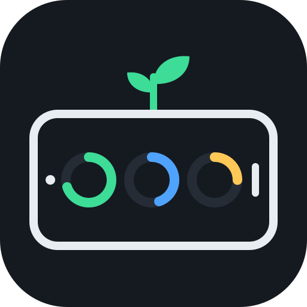
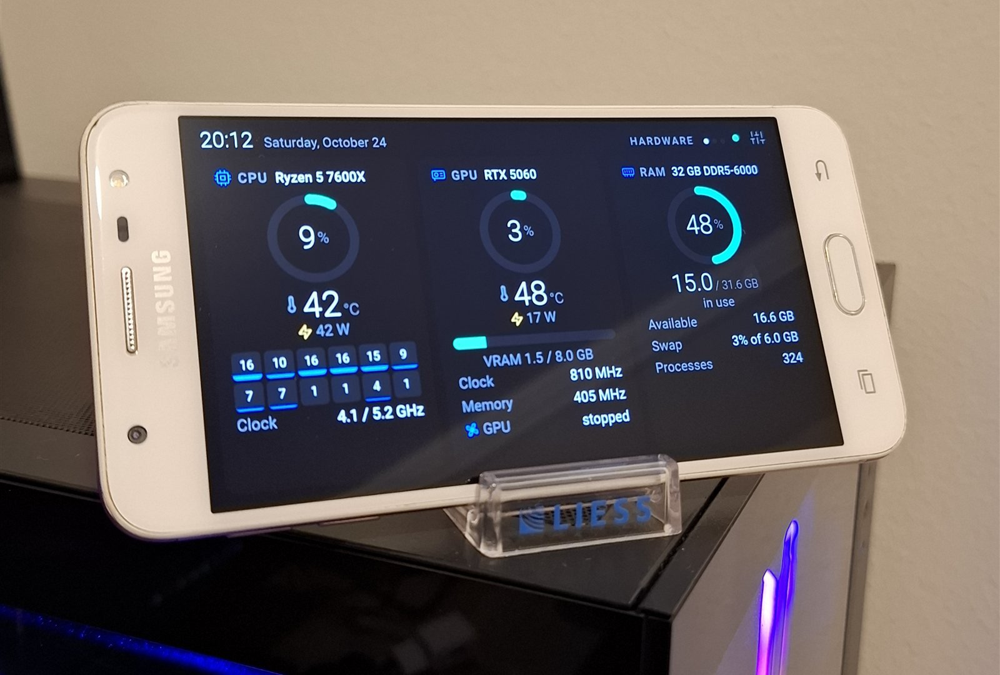
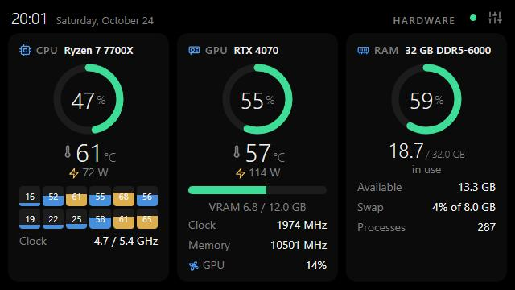
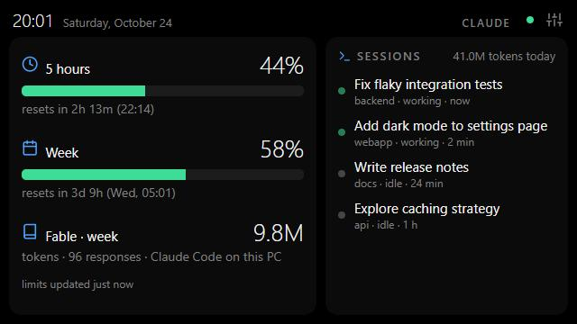
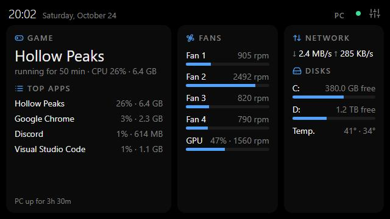
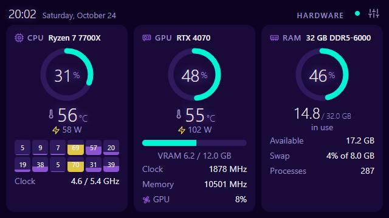
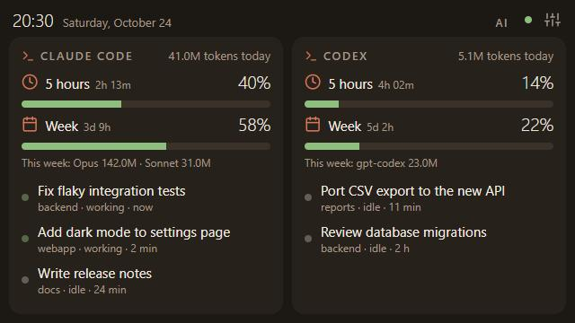
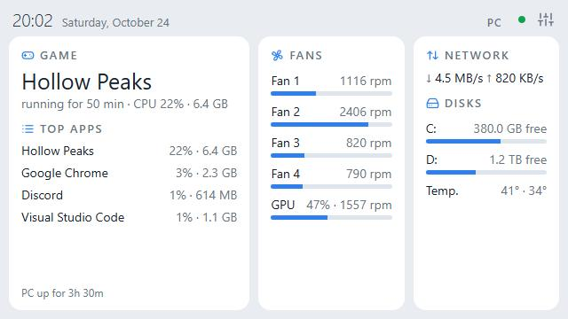

<p align="center">
  
</p>

<h1 align="center">SpareScreen</h1>

<p align="center">Turn an old phone (or any device with a browser) into a live dashboard for your PC.</p>

<p align="center">
  <a href="https://github.com/gustacassel/SpareScreen/actions/workflows/ci.yml"></a>
  <a href="LICENSE"></a>
</p>

<p align="center">
  
</p>

<p align="center">
  
  
  
</p>

Turn that old phone in your drawer into a live dashboard for your computer.
Your PC runs a small Python agent that collects the data and serves a web page;
the phone (or any device with a browser) just opens that page.

The page has three screens that rotate on their own (or with a tap):

- **Hardware:** CPU and GPU usage, temperature, power and clock, per-core load,
  VRAM, RAM and swap.
- **Claude:** Claude Code usage limits (5-hour and weekly windows), Fable tokens this
  week, tokens used today and your open sessions (and which ones are working).
- **PC:** the game you're playing (and for how long), the app in focus, the heaviest
  apps, fans, network, free disk space and drive temperatures.

When a Claude Code session finishes, the page jumps to the Claude screen, shows the
session name and plays a short chime (sound only works after the first tap on the
screen, a browser rule).

Runs on Windows, Linux and macOS, with any device that has a browser.
Free and open source (MIT license). Ideas and next steps in [ROADMAP.md](ROADMAP.md).

## Getting started

You need [Git](https://git-scm.com/) and [Python](https://www.python.org/) 3.9 or newer.
Download the project and enter the folder:

```bash
git clone https://github.com/gustacassel/SpareScreen.git
```

```bash
cd SpareScreen
```

Create a Python environment just for it:

```bash
python -m venv .venv
```

Activate it (Windows: `.venv\Scripts\activate`; Linux/macOS: `source .venv/bin/activate`) and install:

```bash
pip install -e .
```

```bash
sparescreen
```

You can connect the phone in two ways: over Wi-Fi or with a USB cable.

### Over Wi-Fi

The agent prints the address to open on the phone, something like `http://192.168.0.10:8765`.
The phone must be on the same Wi-Fi network as the PC. Any device with a browser works:
Android, iPhone, iPad, a tablet, another computer.

### With a USB cable (Android)

Works without Wi-Fi and keeps the phone charging. It uses `adb reverse`, so the
phone reaches the agent at `http://localhost:8765` through the cable.

1. Install `adb` (Android Platform Tools) on the PC:
   - Windows: `winget install Google.PlatformTools`
   - macOS: `brew install --cask android-platform-tools`
   - Linux (Debian/Ubuntu): `sudo apt install adb`
2. On the phone, enable USB debugging: open *Settings > About phone*, tap
   *Build number* 7 times, then turn on *Developer options > USB debugging*
   (menu names vary a little between brands).
3. Run `sparescreen` and plug in the cable. The first time, accept the
   "Allow USB debugging?" prompt on the phone (check "Always allow").
4. The page opens by itself in the phone's browser. Unplug and plug it back in and it
   comes back by itself.

The cable must carry data (some cheap cables only charge). If the agent can't find
`adb`, use `--adb PATH`. On Windows, some phones need the manufacturer's USB driver.

### Options

| Option | Default | What it does |
|---|---|---|
| `--port` | `8765` | HTTP port |
| `--host` | `0.0.0.0` | Address to listen on. USB only: use `127.0.0.1` so nothing is exposed on the network |
| `--interval` | `1` | Seconds between readings |
| `--no-usb` | | Don't look for phones on USB |
| `--adb` | auto | Path to `adb` |
| `--no-open` | | Don't open the page on the phone when it connects |
| `--stay-awake` | | Turns on the phone's "stay awake while plugged in" setting (saved on the phone) |
| `--dev` | | Development mode (see below) |
| `--demo` | | Show made-up data instead of this PC's (for screenshots, demos or trying it out) |

## On the phone

1. Open the address in the browser (automatic over USB).
2. Tap the screen to go full screen. Each tap goes to the next screen
   (or closes an open notification).
3. Long press (hold ~1 second) switches the theme.
4. The gear icon in the top corner opens **settings**: theme, which screens rotate,
   how often to switch, Claude alerts, sound, fan names and which fan shows on the
   CPU card. Everything is saved on the PC (`~/.sparescreen/config.json`), so it
   survives reloading the page.
5. To keep the screen on: use `--stay-awake` over USB, or keep the phone charging and
   turn on *Developer options > Stay awake*.

Themes: Graphite, OLED, Terracotta, Neon, Terminal and Light.

<p align="center">
  
  
  
</p>

For testing you can force things in the address: `…:8765/?screen=pc` pins one screen
(`hardware`, `claude` or `pc`) and `…:8765/?theme=neon` forces a theme.

## Games and apps

- **Game running:** any program running from a store's game library folder
  (Steam `steamapps/common`, Epic Games, GOG, Xbox, Riot, EA, Ubisoft, Battle.net).
  The name shown is the game's folder name. Games installed elsewhere don't show up.
- **In focus:** the app of the active window (Windows only, for now).
- **Top apps:** processes added up per executable (all Chrome tabs count as one),
  sorted by CPU. The % is of the whole processor.
- No FPS yet: on Windows that needs tools such as PresentMon.

## Temperatures, fans and GPU

| | Windows | Linux | macOS |
|---|---|---|---|
| CPU usage, RAM, disks, network | ✅ | ✅ | ✅ |
| CPU temperature, fans, drive temps | LibreHardwareMonitor | ✅ hwmon | ❌ not yet |
| GPU NVIDIA | ✅ `nvidia-smi` | ✅ `nvidia-smi` | ❌ |
| GPU AMD / Intel | LibreHardwareMonitor | AMD ✅ (`amdgpu`), Intel ❌ | ❌ |

- **NVIDIA:** read from `nvidia-smi`, which ships with the driver. Nothing to set up.
- **Windows (CPU temperature, fans, drives, AMD/Intel GPUs):** Windows only exposes
  these sensors to programs that ship their own driver, so SpareScreen reads them from
  [LibreHardwareMonitor](https://github.com/LibreHardwareMonitor/LibreHardwareMonitor):
  1. Install it: `winget install LibreHardwareMonitor.LibreHardwareMonitor`
  2. Run it as administrator.
  3. Turn on *Options > Remote Web Server > Run* (port 8085, the default).
  4. So you don't have to remember: also turn on *Options > Start Minimized*,
     *Minimize To Tray* and *Run On Windows Startup*.
- **Linux:** CPU temperature (`k10temp`/`coretemp`) and fans come straight from `hwmon`;
  AMD GPUs from the `amdgpu` driver's sysfs files. No root needed.
- **Fans:** motherboard fans show up as "Fan 1", "Fan 2"... (the header number). Fans at
  0 rpm are hidden, since they're usually empty headers. The GPU fan shows "stopped"
  when the card turns it off at idle. Every board wires things differently, so
  SpareScreen doesn't guess which fan is which: in *settings* you can name them
  (e.g. "Fan 2" → "Radiator") and pick which one shows on the CPU card (none by default).

## Claude Code limits (5-hour and weekly)

Claude Code only hands these numbers to its **status line**, so SpareScreen ships a
status line command that saves the limits to a file (`~/.sparescreen/claude-limits.json`)
that the agent reads. In `~/.claude/settings.json`:

```json
"statusLine": {
  "type": "command",
  "command": "PATH/TO/SpareScreen/.venv/Scripts/sparescreen-statusline.exe"
}
```

(On Linux/macOS: `.venv/bin/sparescreen-statusline`.) The status line also shows the
model, context usage and limits in Claude Code's own bar, e.g. `Opus · ctx 34% · 5h 23% · week 41%`.

Limitations:

- Only on Pro and Max plans, and the numbers only update while a Claude Code session is
  open **in a terminal**. The desktop app doesn't run status lines.
- It replaces any status line you already have.
- The model-specific weekly limit isn't in the status line. Instead, SpareScreen shows
  how many tokens Fable used inside the weekly window, counted from this PC's Claude
  Code history (usage on claude.ai or other computers is not included).

## Development

Run `sparescreen --dev`. The agent restarts itself when a `.py` file changes, and the
page on the phone reloads by itself when something in `sparescreen/web/` changes or the
agent restarts. No need to touch the phone.

The page is a frame (`index.html`) that stays full screen and loads the dashboard
(`app.html`) inside it. Only the inner page reloads, so the phone stays full screen.

Run the tests (standard library only, no extra install):

```bash
python -m unittest discover -s tests -t .
```

They also run on GitHub Actions on Windows, Linux and macOS for every push.
`sparescreen --demo` shows made-up data, handy when working on the page.

The page must keep working on old browsers (Chrome 49 / iOS 10): plain JavaScript,
no modern syntax (a test checks this). See [CLAUDE.md](CLAUDE.md) for the project guidelines.

## Troubleshooting

- **The phone can't open the page (Windows):** the first time, Windows asks whether
  Python may accept connections. Allow it on *private networks*. If your Wi-Fi is set
  as *public*, switch it to *private* or allow port 8765 in the firewall.
- **Privacy on Wi-Fi:** any device on the same network can open the page and see your
  Claude session names and running apps. On a network that isn't yours, use USB only
  with `--host 127.0.0.1`.
- **Red dot in the top corner:** the phone lost its connection to the agent.
  The page reconnects by itself when the agent is back.

## How it works

- `sparescreen/sources.py`: CPU, RAM, network and disk usage via `psutil`.
- `sparescreen/sensors.py`: temperatures, fans, drives and GPU (`nvidia-smi`, LibreHardwareMonitor, hwmon, amdgpu).
- `sparescreen/claude.py`: reads `~/.claude` (or `CLAUDE_CONFIG_DIR`). Open sessions come
  from `sessions/*.json`; tokens come from the last 8 days of `projects/**/*.jsonl`
  history, reading only the new part every 5 seconds and adding up 15-minute buckets.
  These are Claude Code's internal formats and may change between versions.
- `sparescreen/statusline.py`: the status line that saves the limits for the agent.
- `sparescreen/server.py`: standard-library HTTP server. The page gets the data through
  Server-Sent Events on `/events`, once per second.
- `sparescreen/usb.py`: every 3 seconds checks `adb devices`, sets up `adb reverse` on
  connected phones and opens the page on them.
- `sparescreen/activity.py`: running game, app in focus and top apps.
- `sparescreen/config.py`: preferences saved in `~/.sparescreen/config.json` (POST `/config`).
- `sparescreen/dev.py`: `--dev` mode (a supervisor that restarts the agent, plus the code version).
- `sparescreen/hwinfo.py`: short CPU, GPU and memory names.
- `sparescreen/demo.py`: made-up data for `--demo`, same shape as the real sources.
- `sparescreen/web/`: the page (plain HTML, CSS and JS, built for old browsers).
  `index.html` is just the frame; the dashboard is `app.html`, `app.js` and `style.css`.

## License

[MIT](LICENSE): use, copy, modify and distribute it freely, including in commercial
projects, as long as you keep the license notice.
